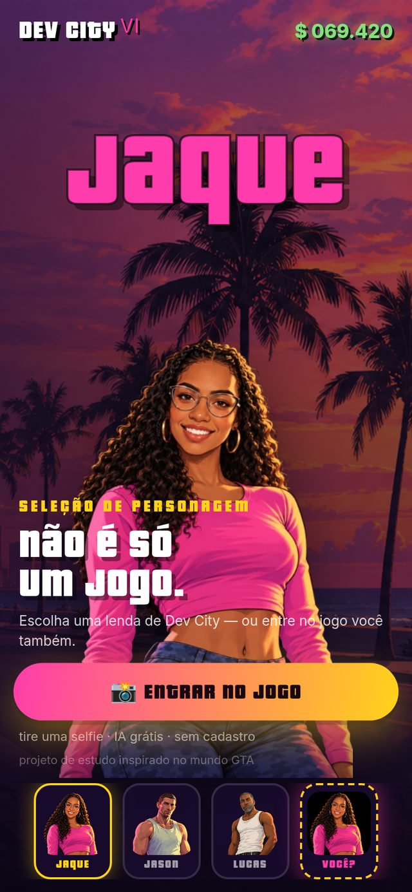
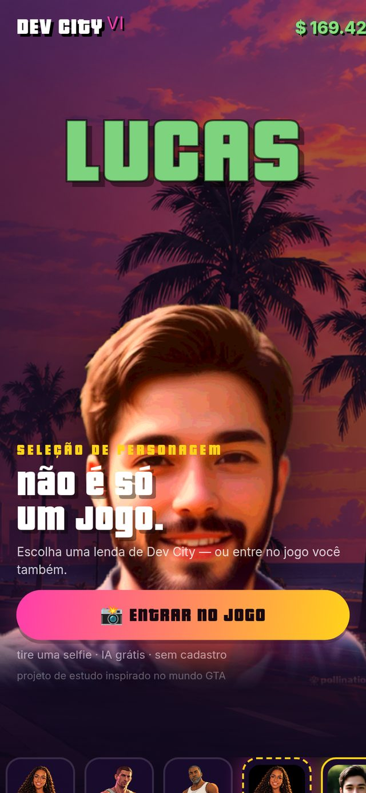

<div align="center">

# 🎮 DEV CITY

### 🌴 Tire uma selfie e entre no mundo GTA — de graça e sem login!

[](https://hdjlucas-maker.github.io/dev-city/)


</div>

---

## 🌐 Jogue agora (link direto)

### 👉 **https://hdjlucas-maker.github.io/dev-city/**

> 📱 **Dica:** no **celular** fica incrível — abre a câmera nativa e a selfie sai em
> alta qualidade. No computador funciona também (webcam ou foto do computador).
> **Nada para instalar, nada de cadastro, nada de pagar.**

## 📸 Um gostinho

| 🏠 Tela inicial | 📸 Estúdio Selfie |
| :---: | :---: |
|  |  |

| 🌴 Resultado (você no mundo GTA) | 🕺 Você no palco |
| :---: | :---: |
|  |  |

## ✨ O que tem no site

- 🏠 **Palco estilo seleção de personagem** — Jaque, Jason e Lucas com cards,
  nome gigante, dinheiro subindo no HUD (R$ 169.420!) e visual fiel ao GTA
  (fonte Pricedown, degradês rosa→amarelo, palmeiras ao pôr do sol);
- 🌴 **Estúdio Selfie — modo principal "ME COLOCAR NO MUNDO GTA"**: uma IA
  **no seu aparelho** recorta você da selfie (rosto, cabelo e corpo **reais**,
  sem inventar nada!) e coloca em pé dentro de um cenário de Dev City, com
  sombra, luz de pôr do sol e título de capa de jogo;
- 🎭 **Estúdio Selfie — modo "VIRAR A LENDA"**: uma IA grátis na nuvem (sem
  login!) troca o seu rosto na arte do personagem escolhido. Se a IA falhar, o
  site cai **automaticamente** no modo 🌴 — nunca fica sem arte;
- 💾 **Salve a imagem** no celular/PC e compartilhe à vontade (1080×1350,
  tamanho ideal para Stories);
- 🃏 **Card "SUA LENDA"** — sua criação vira um card no palco e você pode voltar
  nela quando quiser;
- 🔒 **Privacidade em primeiro lugar** (veja abaixo);
- 📱 **Mobile-first de verdade** — câmera nativa, botões grandes, funciona em
  qualquer celular moderno.

## 🕹️ Como usar

1. Aperte **📸 ENTRAR NO JOGO**;
2. Tire uma **selfie** (no celular abre a câmera nativa de tela cheia);
3. Digite seu **nome de jogador** e escolha a cor;
4. Aperte **🌴 ME COLOCAR NO MUNDO GTA** — em segundos a IA local recorta você
   e monta a capa;
5. Quer mais? Escolha **JAQUE / JASON / LUCAS** e aperte **🎭 VIRAR A LENDA**
   para a IA trocar seu rosto na arte do personagem;
6. **ENTRAR NO JOGO** → você aparece no palco de Dev City! 🎉

## 🧠 Como funciona por dentro (resumo)

Tudo roda **no navegador de quem visita** — sem servidor, sem instalação:

| Camada | Tecnologia | Para quê |
| --- | --- | --- |
| 🕵️ IA local | **MediaPipe (BlazeFace)** | Achar e enquadrar o rosto na selfie |
| ✂️ IA local | **MediaPipe (Selfie Segmenter)** | Recortar a pessoa do fundo (a máscara vira transparência) |
| 🎨 Canvas | **JavaScript puro** | Filtro "desenho" (posterização), cenário, sombra, título |
| 🎭 IA na nuvem | **Hugging Face Space** (`tonyassi/face-swap`) | Trocar o rosto na arte do personagem (grátis, sem login) |
| 🖼️ Cenários | **Pollinations** (pré-gerados em `img/cenarios/`) | 4 cenários guardados no projeto, zero chamadas em tempo real |

Quer entender **cada truque** (máscaras, loops de pixels, SSE do Gradio...)?
Leia o **[📚 APRENDER.md](APRENDER.md)** — guia didático em português. 😉

## 💻 Rodar no seu computador

```bash
./abrir-site.sh
```

- 💻 No computador: `http://localhost:8000`
- 📱 No celular (mesma rede Wi-Fi): o script mostra o endereço, tipo `http://192.168.x.x:8000`

> O script só precisa do **Python 3** (já vem no Linux). É só um servidorzinho
> de arquivos — o site em si é 100% estático.

## 📁 Estrutura do projeto

| Arquivo | O que é |
| --- | --- |
| `index.html` | A estrutura: HUD, palco, cards e o estúdio de 4 passos |
| `styles.css` | O visual: fonte Pricedown, degradês, mobile-first |
| `scripts.js` | Toda a inteligência do site, comentada em português |
| `abrir-site.sh` | Liga o servidor local e mostra o endereço para o celular |
| `img/` | Artes dos personagens + `img/cenarios/` (4 cenários de IA) |
| `docs/` | Prints de tela usados neste README |
| `APRENDER.md` | Guia didático: como cada IA e cada truque funcionam |
| `README.md` | Este arquivo :) |

## 🧪 Testado de verdade

Um robô de navegador (Puppeteer/Chrome) testou os 3 cenários de verdade:

1. 📱 **Celular emulado (iPhone)** — selfie realista → recorte da pessoa + mundo
   GTA **em 3 segundos** → entrar no jogo ✅
2. 💻 **PC com webcam** — vídeo ao vivo → capturar → mundo GTA ✅
3. 🖥️ **PC sem webcam** — o site cai sozinho no modo "escolher uma foto" →
   troca de rosto na nuvem em ~10s ✅

Console limpo nos três casos. 🧼

## 🔒 Privacidade, em bom português

- A selfie **não fica guardada em lugar nenhum** (nem aqui, nem em servidor);
- No modo **🌴 me colocar no mundo GTA**, a foto **não sai do aparelho** —
  recorte, filtro e composição rodam 100% localmente;
- No modo **🎭 virar a lenda**, a selfie é enviada **só na hora** para o Space
  público do Hugging Face (quem faz a troca) e o resultado volta para o seu
  aparelho;
- As IAs locais (detector de rosto e recorte) também rodam 100% no aparelho.

## ⚠️ Notas honestas

- O Space de troca de rosto é **público e comunitário**: às vezes fica na fila.
  Por isso existe o plano automático (modo 🌴) e o botão **OUTRA VERSÃO**;
- O modelo de troca de rosto é gratuito para **uso pessoal/estudo** — este é um
  projeto de aprendizado, não um produto comercial;
- Os cenários foram desenhados pela IA grátis **Pollinations** (sem chave de API)
  e ficam guardados no projeto;
- Fonte **Pricedown** (a "fonte do GTA") via
  [cdnfonts](https://fonts.cdnfonts.com/css/pricedown).

## 👨‍👩‍👧 Feito com carinho

Projeto de estudo da família: **Jaque** (a lenda do palco) e **Lucas** (o dev). 💜

Se você chegou até aqui, você já entendeu mais de IA no navegador do que 99%
das pessoas. Deixe uma ⭐ no repositório se o Dev City te divertiu! 🎮
